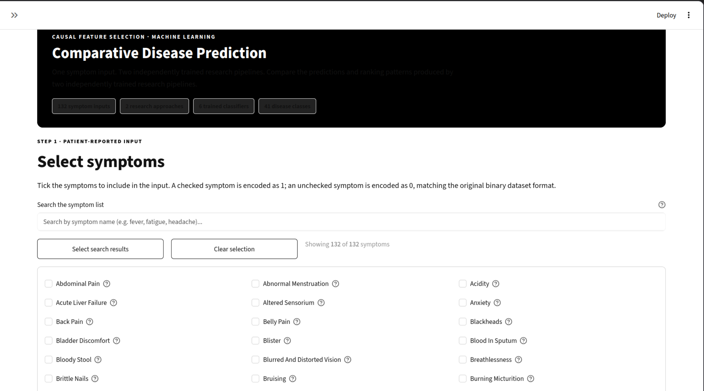
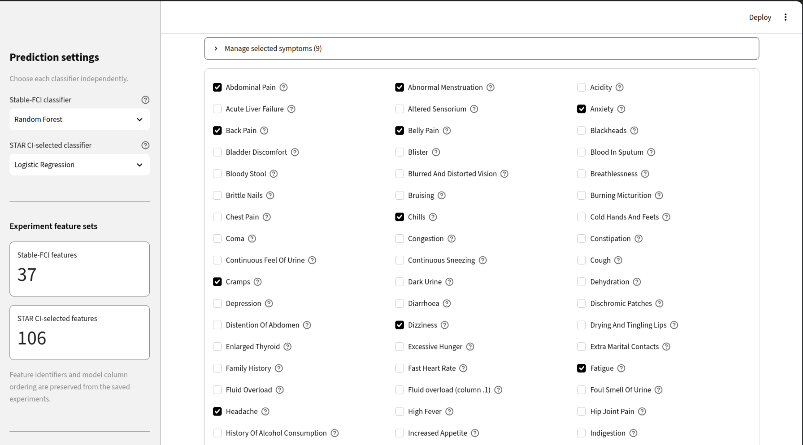
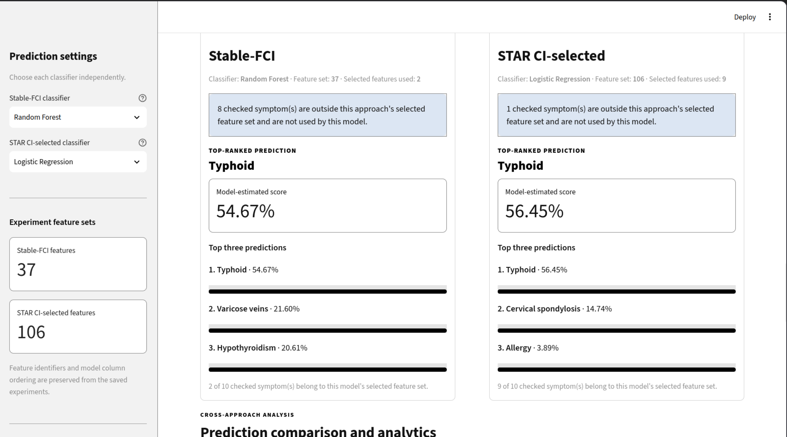
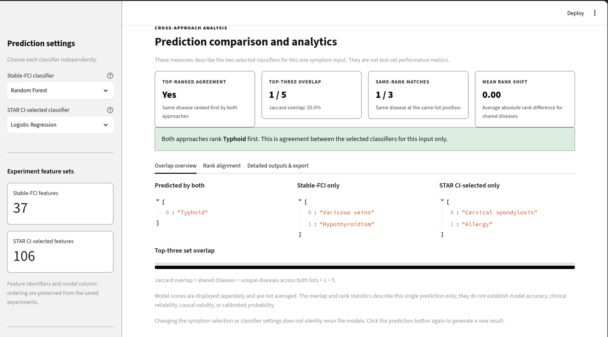

# Comparative Disease Prediction Using Stable-FCI and STAR CI-Selected Features

A research prototype that investigates two conditional-independence-based symptom-selection approaches and deploys their separately trained classifiers in one interactive disease-prediction application.

The project keeps the two experimental pipelines independent. Given the same 132-symptom input, the application maps the input to each method's saved feature schema and returns separate top-three predictions. It does **not** combine the classifiers into an ensemble or average their scores.

> **Research-use notice:** This project is an experimental research prototype, not a medical device or clinical decision-support system. Its outputs are not diagnoses and must not be used to make medical decisions. The displayed percentages are model `predict_proba` scores; probability calibration and clinical validity have not been established.

---

## At a glance

| Item | Stable-FCI pipeline | STAR CI-selected pipeline |
|---|---:|---:|
| Disease classes | 41 | 41 |
| Input symptom variables | 132 | 132 |
| Selected symptom variables | **37** | **106** |
| Training records | 3,936 | 4,920 |
| Test records | 984 | 42 |
| Classifiers | Logistic Regression, Random Forest, XGBoost | Logistic Regression, Random Forest, XGBoost |

The selected feature lists contain 29 symptoms in common, 8 selected only by Stable-FCI, and 77 selected only by STAR CI-selected. Eighteen master symptom identifiers are selected by neither approach.

**Important:** The two experiments use different training/testing protocols and different test-set sizes. Their historical metrics are reported in their original contexts and must not be interpreted as a controlled head-to-head performance comparison.

---

## Application preview

The Streamlit application provides a common symptom-selection interface and two independent prediction panels.

<!-- Keep the image filenames in sync with the files in screenshots/. -->

| Symptom selection | Stable-FCI prediction |
|---|---|
|  |  |

| STAR CI-selected prediction | Prediction comparison |
|---|---|
|  |  |

If your local screenshot filenames differ, rename the files or update the relative paths above so the images render correctly on GitHub.

---

## Research question

**Given the same patient-reported symptom input, how do classifiers trained on features selected by Stable-FCI differ from classifiers trained on features selected by a disease-specific STAR CI-screening procedure?**

This project makes the resulting model outputs inspectable in a single interface while preserving the original feature-selection methods, trained classifiers, and experiment configurations.

## Methodology

### 1. Stable-FCI feature-selection pipeline

Stable-FCI is applied to the training partition of a binary disease-symptom dataset. The constraint-based FCI workflow uses G² conditional-independence testing and background knowledge that constrains the assumed disease/symptom ordering. A Partial Ancestral Graph (PAG) is produced. Symptoms adjacent to disease nodes in the final PAG are retained for downstream classification.

The archived experiment uses bounded search settings, including a maximum conditioning depth of 10 and maximum path length of 10. The selected feature set contains 37 symptoms.

A PAG edge or adjacency is not, by itself, proof of a causal effect. Interpretation depends on the CI-test assumptions, background knowledge, search settings, and available variables.

### 2. STAR CI-selected feature-selection pipeline

The STAR approach performs a custom, disease-specific, two-stage G² conditional-independence screening procedure. It produces a retained symptom set for each disease, then forms a union of the disease-specific retained sets for multiclass classification.

The union contains 106 symptoms. The star-shaped graph visualisations represent the screening output; they should not be interpreted as a complete causally oriented graph inferred by the CI tests.

### 3. Downstream classification

Each feature-selection approach has three separately trained classifiers:

- Logistic Regression
- Random Forest
- XGBoost

The six fitted model artifacts are stored under `artifacts/`. The application loads these saved models; it does not rerun Stable-FCI, STAR screening, or model training during prediction.

### 4. Common application input

The user selects symptoms from the common 132-symptom list. The application creates the appropriate model input by projecting the selection into each approach's exact saved feature identifiers and feature order:

- Stable-FCI classifier input: 37 features.
- STAR CI-selected classifier input: 106 features.

The user can choose the classifier independently for each pipeline. The application displays each pipeline's top-three disease scores and comparative ranking/overlap analytics. It does not average scores across approaches.

---

## Experimental results

The following values are transcribed from the archived experiment summaries. They describe the original experiments, not a new unified evaluation.

### Stable-FCI-selected classifiers

The Stable-FCI experiment used a stratified 80/20 split of 4,920 records: 3,936 training records and 984 held-out test records.

| Classifier | Accuracy | Macro precision | Macro recall | Macro F1 | Top-3 accuracy |
|---|---:|---:|---:|---:|---:|
| Logistic Regression | 80.79% | 76.70% | 80.79% | 77.49% | 92.89% |
| Random Forest | 80.89% | 76.75% | 80.89% | 77.56% | 92.89% |
| XGBoost | 80.79% | 76.70% | 80.79% | 77.49% | 92.89% |

### STAR CI-selected classifiers

The STAR experiment used 4,920 training records and a separate 42-record external test set.

| Classifier | Accuracy | Macro precision | Macro recall | Macro F1 | Top-3 accuracy |
|---|---:|---:|---:|---:|---:|
| Logistic Regression | 97.62% | 98.78% | 98.78% | 98.37% | 97.62% |
| Random Forest | 97.62% | 98.78% | 98.78% | 98.37% | 97.62% |
| XGBoost | 97.62% | 98.78% | 98.78% | 98.37% | 97.62% |

The STAR external test set contains only 42 records across 41 disease classes, with one or two examples per class. These metrics are highly sensitive to individual observations and are preliminary; they are not reliable estimates of population-level performance. They should not be compared directly with Stable-FCI's 984-record test results.

For full context, including cross-validation and the archived baselines, see [`docs/EXPERIMENTAL_RESULTS.md`](docs/EXPERIMENTAL_RESULTS.md) and the source evidence under `research/results/`.

---

## Repository structure

```text
Comparative_Disease_Prediction_Research_Prototype/
├── app.py
├── artifacts/                 # Six fitted model artifacts
│   ├── stable_fci/
│   └── star_ci/
├── configurations/            # Symptom schemas, feature orders, labels, registry
├── core/                      # Input processing, loading, inference, analytics
├── frontend/                  # Streamlit frontend components
├── .streamlit/                # Light black-and-white theme configuration
├── research/
│   ├── notebooks/              # Cleaned publication copies of both experiments
│   ├── results/
│   │   ├── stable_fci/         # PAG outputs, edge tables, metrics, figures
│   │   └── star_ci/            # CI-screening evidence, feature lists, metrics, figures
│   └── methodology/            # Detailed method and evaluation descriptions
├── docs/                       # Project, dataset, architecture, results, limitations
├── reference_reports/          # Saved model/configuration reference reports
├── scripts/                    # Verification and validation scripts
├── tests/                      # Automated tests
├── screenshots/                # Application screenshots used in this README
└── data/                        # Data acquisition and schema instructions; raw data omitted
```

---

## Run the application

### Requirements

The saved model artifacts were produced with pinned versions of scikit-learn and XGBoost. Use the versions recorded in `requirements.txt`. The validated environment used Python 3.14, scikit-learn 1.9.0, XGBoost 3.1.3, and Streamlit 1.66.1.

### 1. Clone the repository

```bash
git clone <YOUR_GITHUB_REPOSITORY_URL>
cd Comparative_Disease_Prediction_Research_Prototype
```

Replace the placeholder URL with the repository URL after creating it on GitHub.

### 2. Create and activate a virtual environment

```bash
python3.14 -m venv .venv
source .venv/bin/activate
python -m pip install --upgrade pip
```

### 3. Install dependencies

```bash
python -m pip install -r requirements.txt
```

### 4. Verify configuration and model artifacts

```bash
python scripts/verify_configuration.py
python scripts/verify_models.py
```

### 5. Run automated tests

```bash
python -m pytest -q
```

### 6. Launch Streamlit

```bash
streamlit run app.py
```

Open the local URL printed by Streamlit, usually `http://localhost:8501`.

---

## Reproducibility and validation

The project includes verification scripts, an artifact hash manifest, curated experiment evidence, and automated tests.

The recorded application validation established that:

- All six saved models load in the pinned environment.
- Each model accepts its expected feature count (37 for Stable-FCI and 106 for STAR CI-selected) and returns 41 disease-class scores.
- Stable-FCI's archived held-out metrics were reproduced for all three classifiers using two structurally valid candidate source datasets.
- STAR inference was checked on all 42 external test symptom rows for all three models.
- STAR Logistic Regression matched the archived 41-class probability vectors for all 42 rows.
- Single-symptom, multi-symptom, all-symptom, and empty-selection input checks passed.
- The latest recorded automated test run reported **20 passed**.

Two different local copies of the Stable-FCI source dataset were found; both reproduced the saved test metrics, but their hashes differ. The available records do not identify which exact copy was originally loaded for the historical notebook run. Raw datasets are not included in this repository.

The XGBoost joblib/pickle artifact emits an upstream serialized-snapshot compatibility warning when loaded. It was non-fatal in the pinned environment and the models passed inference checks. Keep XGBoost pinned to the specified version; do not casually re-save or convert the serialized artifacts.

For detailed procedures, see [`docs/REPRODUCIBILITY.md`](docs/REPRODUCIBILITY.md) and [`docs/application/VALIDATION_RESULTS.md`](docs/application/VALIDATION_RESULTS.md).

---

## Data, privacy, and responsible use

- Raw training and test datasets are not bundled. See [`data/README.md`](data/README.md) for dataset and schema notes.
- Obtain the original data independently and comply with its access, licensing, and redistribution conditions before reproducing experiments.
- Confirm that the trained model artifacts may be redistributed before making this repository public; derived artifacts may be subject to source-data terms.
- Do not commit credentials, private datasets, personal information, local environment files, or restricted clinical data.
- The application is for research demonstration only. It has not been clinically validated, and its displayed model scores are not calibrated diagnostic probabilities.

---

## Documentation and research evidence

Start with [`docs/README.md`](docs/README.md) for the documentation index.

Useful entry points:

- [Project overview](docs/PROJECT_OVERVIEW.md)
- [Dataset description and provenance](docs/DATASET_DESCRIPTION.md)
- [Stable-FCI methodology](research/methodology/STABLE_FCI_METHODOLOGY.md)
- [STAR CI-selected methodology](research/methodology/STAR_CI_SELECTED_METHODOLOGY.md)
- [ML evaluation protocols](research/methodology/ML_EVALUATION_PROTOCOLS.md)
- [Feature-selection comparison](docs/FEATURE_SELECTION_COMPARISON.md)
- [Experimental results](docs/EXPERIMENTAL_RESULTS.md)
- [System architecture](docs/SYSTEM_ARCHITECTURE.md)
- [Application guide](docs/APPLICATION_GUIDE.md)
- [Limitations and future work](docs/LIMITATIONS_AND_FUTURE_WORK.md)

---

## Scope and limitations

This repository demonstrates two CI-based feature-selection experiments and a software application that compares their downstream classifier outputs. It does not establish that either feature-selection approach discovers clinically valid causal relationships or that one approach is superior.

Key limitations include the different historical evaluation protocols, the small STAR external test set, uncertain provenance between two Stable-FCI source-data copies, uncalibrated model scores, and unresolved duplicate-like symptom identifiers (`fluid_overload` and `fluid_overload.1`) retained to preserve the STAR model's expected schema. See [`docs/LIMITATIONS_AND_FUTURE_WORK.md`](docs/LIMITATIONS_AND_FUTURE_WORK.md) for the complete discussion.

## License and citation

A repository license and citation file should be added after the project owner confirms the intended reuse terms and author/citation details. Until a license is included, do not assume that public visibility grants permission to reuse the code, models, or research outputs.
