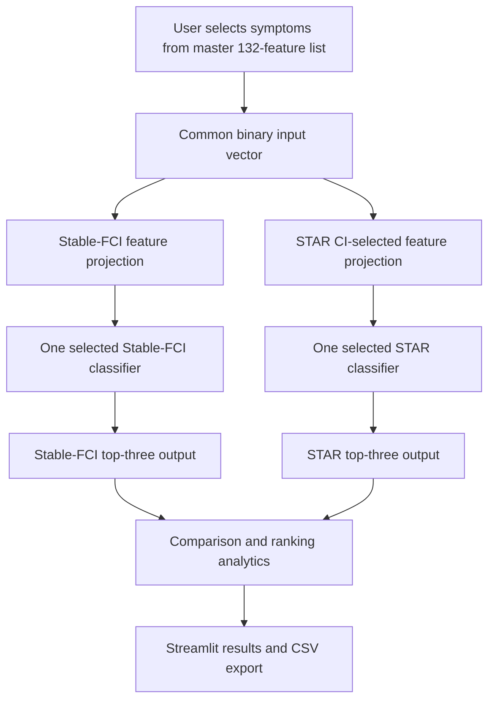

# System Architecture

## High-level design

The application is a deployment layer over two independent, previously trained research pipelines. It does not merge their feature sets or retrain the classifiers.

## Repository modules

| Path | Responsibility |
|---|---|
| `app.py` | Streamlit page flow, symptom-selection interface, classifier selectors, prediction display, comparison and methodology sections. |
| `core/config.py` | Loads application configuration and paths. |
| `core/input_processor.py` | Converts the master symptom selection into each model's required ordered feature vector. |
| `core/model_loader.py` | Verifies model artifact hashes and loads the saved estimators. |
| `core/model_compat.py` | Defines compatibility support for the saved Stable-FCI XGBoost wrapper. |
| `core/prediction_engine.py` | Runs inference and ranks model output scores. |
| `core/prediction_analytics.py` | Computes overlap and rank-alignment summaries. |
| `core/result_comparison.py` | Prepares structured comparison outputs. |
| `configurations/` | Holds master symptom identifiers, selected feature orders, disease labels, model registry, and audit metadata. |
| `artifacts/` | Holds the six trained `.joblib` artifacts. |
| `reference_reports/` | Holds compact archived reference metrics and probability records used for validation. |
| `scripts/` | Holds configuration, model, experiment-input, and integrity validation scripts. |
| `tests/` | Holds unit and integration tests. |

## Input handling

The frontend exposes the master 132-symptom list. A selected checkbox is encoded as 1; an unchecked checkbox is encoded as 0. The current input schema has no separate unknown/missing state.

The common vector is projected into two independent, saved feature orders:

- Stable-FCI: 37 selected features.
- STAR CI-selected: 106 selected features.

Original identifiers and model feature ordering are preserved. A symptom excluded by an approach is not supplied to that approach's model.

## Inference

The user independently chooses one of three classifiers for Stable-FCI and one of three for STAR CI-selected. The application loads the corresponding saved estimator, obtains its `predict_proba` output, and displays the three highest-scoring classes. Original class labels are retained internally; the display layer removes the STAR `disease_` prefix when present.

The displayed percentages are uncalibrated model probability outputs expressed as percentages. They are not medical probabilities or diagnostic certainty.

## Comparison analytics

The analytics layer compares top-three membership and ranking positions. It can report common predictions, unique predictions, top-rank agreement, overlap/Jaccard measures, and rank shifts. It does not average probabilities, blend model outputs, or create an ensemble.

## Artifact integrity and compatibility

`artifact_manifest.json` records the saved model files and SHA-256 hashes. The model loader validates the serialized artifacts and the required runtime versions. The verified model environment uses scikit-learn 1.9.0 and XGBoost 3.1.3. XGBoost emits a non-fatal warning about loading a Python-pickled serialized snapshot; keep the pinned version and do not convert or overwrite the existing artifacts as part of normal setup.
